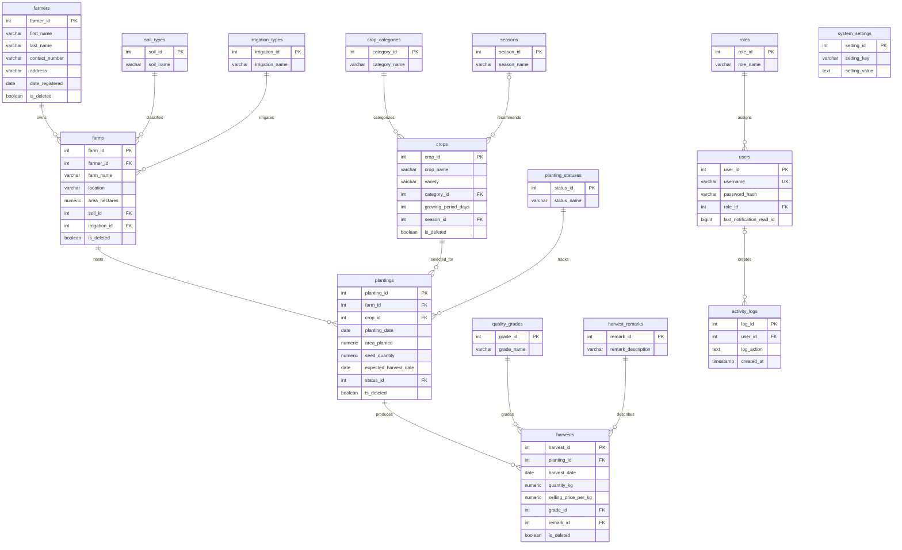

# Growthtopia Entity-Relationship Diagram

The diagram below expresses the relationships in the supplied normalized 3NF schema. The core operational chain is **FARMER 1:M FARM 1:M PLANTING 1:M HARVEST**; each planting also references one crop. Lookup entities store reusable descriptions. This editable Mermaid diagram is based on the submitted schema image and the migration scripts in `supabase/migrations/`.

`season_id` is optional in the supplied normalized schema; the other required relationship IDs are made non-null by the lookup-normalization migration. The `system_settings` key/value table is not connected to the operational record graph.

## Relationship summary

| Parent | Child | Cardinality | Meaning |
|---|---|---:|---|
| `farmers` | `farms` | 1:M | One farmer may own multiple farms; each farm belongs to one farmer. |
| `farms` | `plantings` | 1:M | A farm can host multiple plantings; each planting belongs to one farm. |
| `crops` | `plantings` | 1:M | A crop may be used in multiple plantings; each planting selects one crop. |
| `plantings` | `harvests` | 1:M | One planting can produce multiple harvest records; each harvest refers to one planting. |
| Lookup tables | Operational tables | 1:M | Each selected soil, irrigation, category, season, status, grade, or remark is stored by its lookup ID. |
| `roles` | `users` | 1:M | A role can be assigned to multiple user accounts. |
| `users` | `activity_logs` | 1:M | An account can create multiple activity entries; historical entries may have a null user reference. |

Confirm exact column types, nullability, and constraints against the current Supabase catalog before submitting a database snapshot. See the [data dictionary](DATA_DICTIONARY.md).
